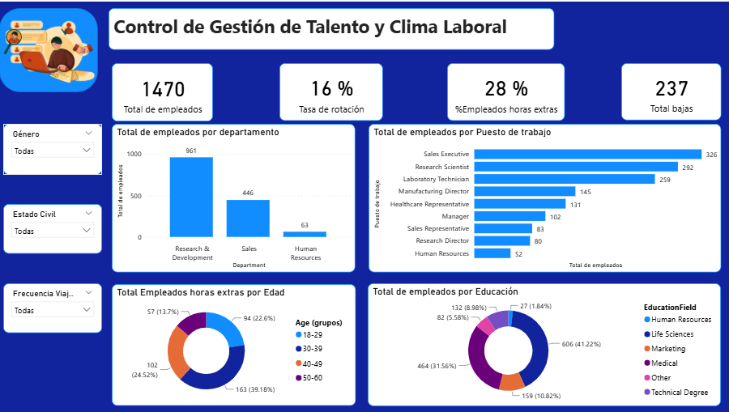
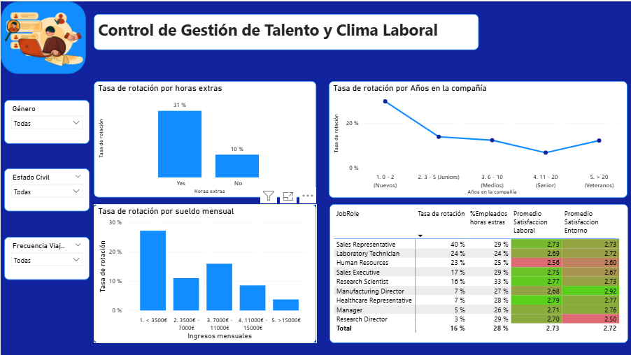
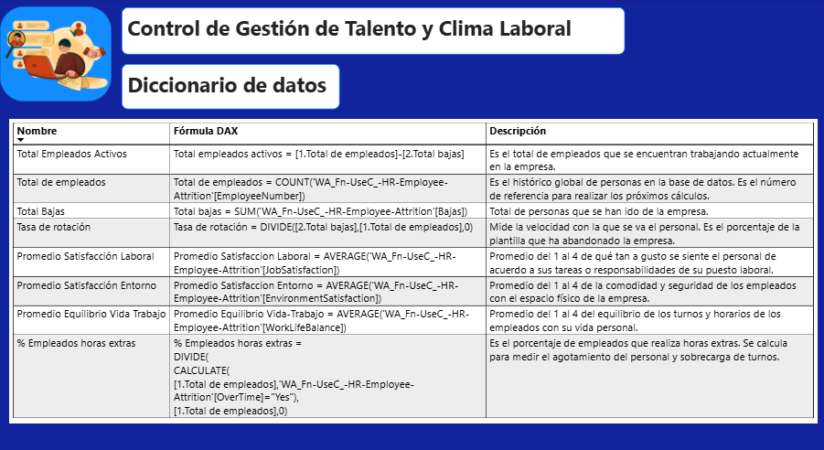

# 👥 HR Analytics: Control de Gestión de Talento y Clima Laboral

## 🎯 Resumen Ejecutivo y Objetivo del Proyecto
Este cuadro de mando en Power BI analiza la rotación de personal (attrition), la satisfacción en el entorno laboral y las horas extras para ayudar a la dirección de Recursos Humanos a identificar las causas principales de la fuga de talento y tomar decisiones de retención basadas en datos.

Indicadores clave monitoreados: **1.470 Empleados Totales**, **16% Tasa de Rotación** y **28% Porcentaje de Horas Extras**.

---

## 📸 Capturas del Dashboard

### 1. Vista General y Demografía de la Plantilla

### 2. Análisis de Rotación e Impacto de Horas Extras

### 3. Diccionario de Datos y Documentación de Medidas DAX

