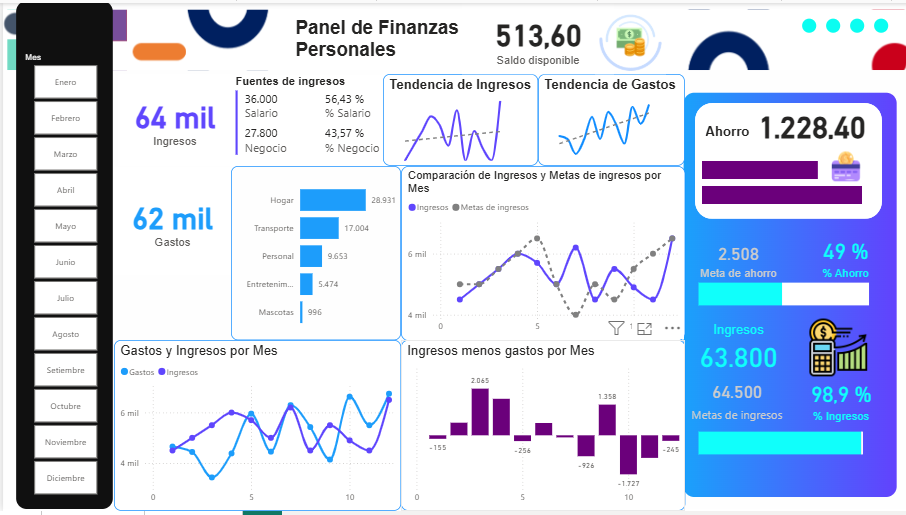

# 💰 Panel de Finanzas Personales y Control Presupuestario

## 🎯 Resumen Ejecutivo y Objetivo del Proyecto
Este dashboard en Power BI permite realizar un seguimiento integral de la salud financiera personal mediante el monitoreo de ingresos, distribución de gastos por categorías, cumplimiento de metas de ahorro y análisis del saldo neto mensual.
---

## 📸 Captura del Dashboard

