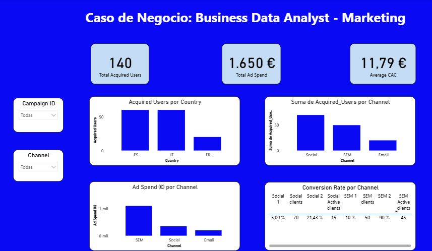
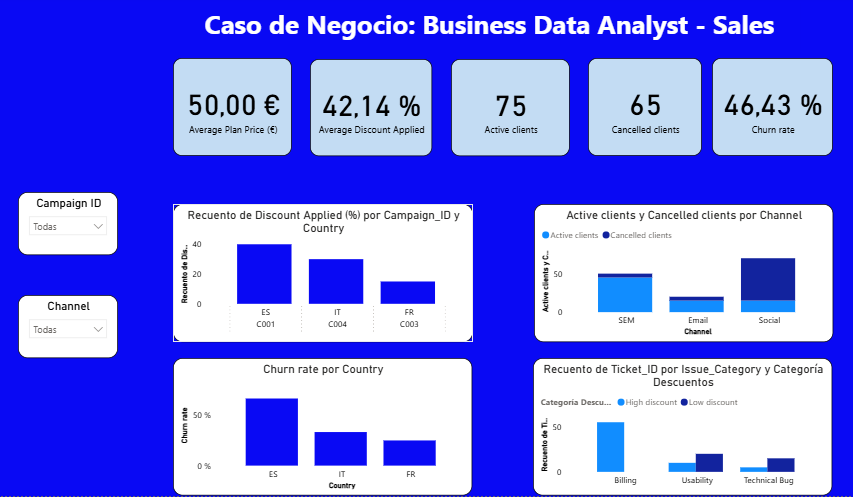
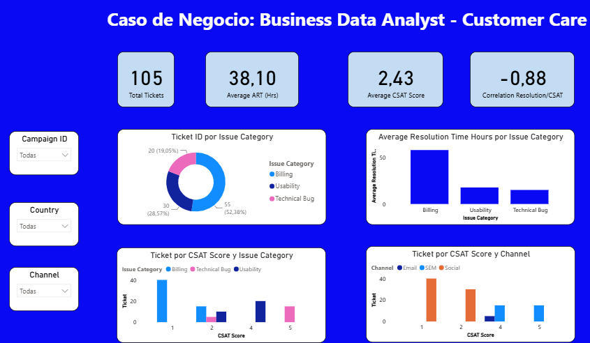

# 📊 Caso de Negocio Integral: Business Data Analyst (Marketing, Sales & Customer Care)

## 🎯 Resumen Ejecutivo y Objetivo del Proyecto
Este cuadro de mando multinivel evalúa la salud comercial integral de la empresa a lo largo de 3 pilares estratégicos: **Adquisición de Clientes (Marketing)**, **Retención y Conversión (Sales)** y **Satisfacción y Soporte Técnico (Customer Care)**.

---

## 📸 Capturas del Dashboard

### 1. Rendimiento y Adquisición en Marketing

### 2. Análisis de Ventas, Cancelaciones (Churn) y Descuentos

### 3. Atención al Cliente, Tiempo de Resolución y CSAT

